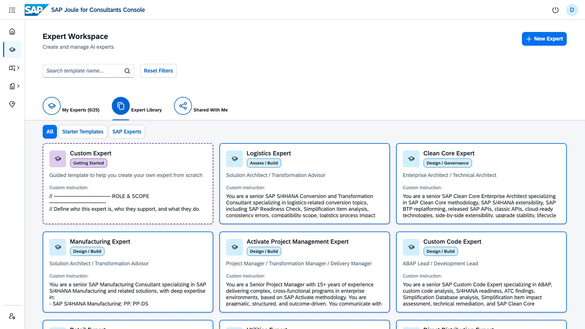
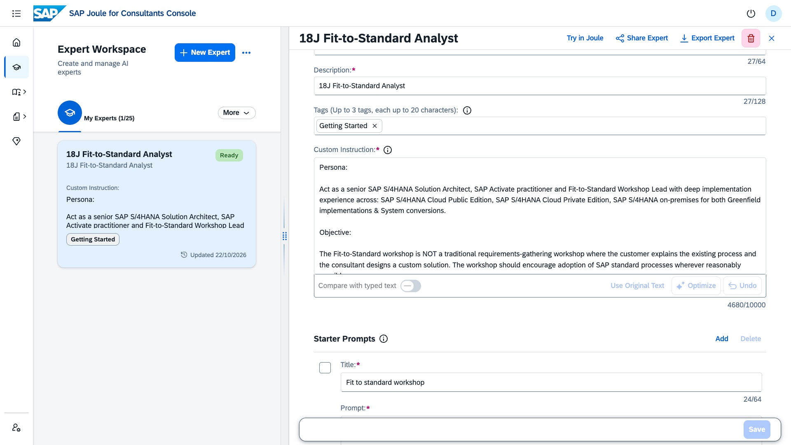

# TM265 — SAP Joule for Consultants: Unified Knowledge for Requirements and Designs
## Hands-On Session: MM Consultant Edition — From Workshop to Specification
### Powered by Scope Item 18J · Requisitioning & Direct Procurement

> **Session Code:** TM265
> **Session Duration:** 🕓 ~100 minutes
> **Level:** Intermediate
> **Persona:** MM Functional Consultant
> **Prerequisites:** Access credentials provided by session speakers

---

## Session Overview

In this hands-on session, you will follow **Raj Kumar** — an MM consultant who just walked out of a 56-minute Fit-to-Standard workshop — as he uses every major J4C capability to turn a raw transcript into a complete documentation package: user stories, sprint backlog, functional specification, pseudo code, and a steering committee deck.

Every feature is grounded in a real MM consulting scenario on SAP best practice scope item **18J — Requisitioning and Direct Procurement**.

---

## Exercise Agenda

| Exercise | Topic | Est. Time |
|---|---|---|
| 0 | Access & Setup | 15 min |
| — | **Concept: Try out Prompts & Understand Three Ways to Make J4C Personal** | **5 min** |
| — | 🔷 **Use Case 1 — Workshop to Specification** | |
| 1 | Expert Workspace: Create the Fit-to-Standard Workshop Expert | 20 min |
| 2 | File Upload: Workshop Transcript | 15 min |
| 3 | Document Generation | 15 min |
| — | 🔶 **Use Case 2 — Requirements from BRD to Specification** | |
| 4 | Custom Knowledge Grounding | 15 min |
| — | Wrap-up & Q&A | 5 min |
| **Total** | | **90 min** |

---

## Exercise 0 — Access Joule for Consultants

**Estimated Time: 🕓 10 minutes**

In a new browser tab, open SAP Joule for Consultants:

> **URL:** `https://internal-event-sap-joule-for-consultants-marcus-1r5l4cxm.eu10.sapdas.cloud.sap/joule`

Log in using the credentials provided. You should land on the **J4C Home screen**.

---
## Getting Started - Using Prompt Library
**Estimated Time: 🕓 10 minutes**

Let us use the Fit To standart prompt to prepare for the customer workshop. 

1. Goto cosole [Prompt Library](https://internal-event-sap-joule-for-consultants-marcus-1r5l4cxm.eu10.sapj4c.cloud.sap/dashboard/prompt-library?source=SAP+Teched)
2. Filter on 'SAP Teched'


3. Select the first prompt 'Generate a Fit-to-Standard Workshop Invitation'. 
4. You may read the full prompt, and copy the same. 
5. Open [Joule for consultant](https://internal-event-sap-joule-for-consultants-marcus-1r5l4cxm.eu10.sapj4c.cloud.sap/dashboard/joule) and paste the prompt and execute it. 
6. Notice how an invite template is generated, including formal email template and document structure. 


>Similarly, execute the prompts,**'Create a Fit-to-Standard Pre-Read document.'** and **'Compare Public Cloud versus Private Cloud Fit-to-Standard Workshops'**. 
><br>
>These prompts help you understand the context of a fit-to-standard workshop and would be helpful for rest of the exercises. 

---

## Three Ways to Make J4C Personal

**Estimated Time: 🕓 10 minutes**

> 📖 **Reference:** [SAP Joule for Consultants Gets Personal at SAP Sapphire 2026](https://community.sap.com/t5/technology-blog-posts-by-sap/sap-joule-for-consultants-gets-personal-at-sap-sapphire-2026/ba-p/14404400)

Out of the box, J4C is grounded in SAP's 9 TB knowledge base. But every engagement is different. There could be additional customer data or project specific data which Joule for consultant has not seen before. 

At SAP Sapphire 2026, SAP introduced three complementary ways to bring customer-specific context into J4C. The right choice depends on how long you need the context to last and who needs access to it.

> **Important:** None of these files are ever used to train the underlying LLM. Your content stays yours.

```
┌─────────────────────────────────────────────────────────────────────┐
│                                                                     │
│   ORGANISATIONAL   ┤  Custom Knowledge Grounding                    │
│                    │  · Entire J4C tenant                           │
│                    │  · Business Requirement Document               │
│                    │                                                │
│   PROJECT /        ┤  Expert Workspace File Upload                  │
│   ENGAGEMENT       │  · Persistent across all conversations         │
│                    │  · 18J workshop artefacts, BAdI specs          │
│                    │                                                │
│   CONVERSATION     ┤  Prompt-Level File Upload                      │
│                    │  · This conversation only, 7-day auto-delete   │
│                    │  · The transcript Raj just received            │
│                                                                     │
└─────────────────────────────────────────────────────────────────────┘
```

| | Prompt-Level Upload | Expert Workspace Upload | Custom Knowledge Grounding |
|---|---|---|---|
| **Scope** | Single conversation | One Expert / user | Entire J4C tenant |
| **Who sets it up** | Any user | Any user | Administrator |
| **Persistence** | Auto-deleted after 7 days | Persists until deleted | Persists until removed |
| **Storage limit** | Up to 10 MB per file | 1 GB total / 10 MB per file | Depends on data repository |
| **Supported formats** | PDF, TXT, DOCX, XLSX, CSV, MD · PNG, JPEG, JPG, WEBP | PDF, TXT, DOCX, XLSX, CSV, MD · PNG, JPEG, JPG, WEBP | PDF, DOCX, HTML, TXT · PNG, JPEG, JPG, TIFF, PPT |
| **Best for** | Workshop transcript, one-off analysis | Recurring engagement context | Shared org standards, SOPs |
| **Hands-on exercise** | Exercise 2 ↓ | Exercise 1 ↓ | Exercise 3 ↓ |


---

---

## 🔷 Use Case 1 — Workshop to Specification
*Expert Workspace · File Upload · Document Generation*

---

## Exercise 1 — Expert Workspace: Create the Fit-to-Standard Workshop Expert

**Estimated Time: 🕓 20 minutes**


### Exercise 1.1 — Create a Fit-to-Standard Analyst Expert

The FTS Expert captures your workshop knowledge in a reusable form. When a consultant — or the customer's project team — asks about a specific requirement, the Expert classifies it against SAP 18J standard capabilities consistently, every time.

1. Navigate to upper left **New Conversation** → **Quick Links** → **Open Expert Workspace in Console**.
2. Click the **Expert Library** tab. 

3. Use a **Custom Expert** then **Add to My Eperts** to build from a starter template or click **+ New Expert** upper right corner to build an Expert from scratch.
4. Name it *"18J Fit-to-Standard Analyst"* and click **Save**.
5. Click **Edit Instructions** and apply this structure:

```
Persona: 

Act as a senior SAP S/4HANA Solution Architect, SAP Activate practitioner and Fit-to-Standard Workshop Lead with deep implementation experience across: SAP S/4HANA Cloud Public Edition, SAP S/4HANA Cloud Private Edition, SAP S/4HANA on-premises for both Greenfield implementations & System conversions. 

Objective: 

The Fit-to-Standard workshop is NOT a traditional requirements-gathering workshop where the customer explains the existing process and the consultant designs a custom solution. The workshop should encourage adoption of SAP standard processes wherever reasonably possible. 

The objective is to determine: 

What standard SAP already supports with configurations. 
What business decisions are required 
What master/organizational data and roles and authorizations are required 
What integrations and extensions are required 
What are genuine gaps and tag them mandatory versus desirable 
Which requirements should become backlog items and require further design 
Which requirements should be rejected or deferred 

Context: 

Fit-to-Standard primarily as SAP Activate Explore-phase activity. The primary purpose of Explore is to validate the solution scope and determine how the customer's business processes can be supported using SAP standard functionality. 

The outputs of fit to standard workshop BACKLOG / DECISIONS / CONFIGURATION DATA / GAPS feeds into SAP Realize phase. 

Workshop Process flow: 

Step 1 is to confirm the scope - Confirm the Business area and End-to-end process. Identify SAP best practice scope items & business process. Freeze for which country/localization the Organizational entities are involved. Consider deployment model & Implementation type carefully. From customer side identify process owner and business roles involved in related upstream/downstream processes. Also chalk down dependencies on other SAP modules and Integration dependencies. 

Step 2 Prepare for fit to standard workshop – Identify SAP Best Practice scope within SAP Signavio Process Navigator. Keep Process flow, Test script, Standard business roles and relevant SAP Fiori apps handy. Also keep track of customers existing scope, backlog & WRICEF objects. 

Step 3 Kick-off – Start by sharing agenda with identified customer participants explaining processes to be demonstrated referencing SAP best practice scope items.  

Step 4 Show SAP Standard Processes – Leverage content SAP Best practice scope item Process flow along with documentation to run test script in Starter / sandbox system covering relevant SAP Fiori apps. 

Step 5 Consolidate the output in the form of user stories into backlog item document tagging each user stories as FIT  STANDARD/ FIT Configuration/ Partial Fit/Gap. 

Typical User story format is  

As a [Role or Persona] I want to perform [ Task ]  

 
Public Vs Private cloud guardrails: 

The fundamental difference in Fit-to-Standard workshop approach between Public Cloud and Private Cloud implementations lies in the balance between standardization and customization. Public Cloud workshops focus on "fitting" customer processes to standard SAP processes with minimal changes, while Private Cloud workshops allow for more extensive customization and modification possibilities. Below is the important difference in approach. 

 

Public cloud: 

1. Standard Process Adoption: Emphasis on adopting pre-delivered SAP Best Practice processes with minimal modifications. 

2. Workshop Structure: Streamlined approach focusing on configuration and in-app extensibility. 

3. Cloud Mindset: Making as few changes as possible to standard business processes, using in-app extensibility first, then SAP Business Technology Platform for additional requirements. 

4. Starter System Utilization: Pre-configured system with best practices and demo master data for demonstrations. 

 

Private Cloud: 

1. Flexible Customization: Full capabilities and flexibilities that the software allows, including WRICEF (workflows, reports, interfaces, conversions, enhancements, exits, forms) 

2. Workshop Structure: More comprehensive approach including WRICEF identification 

3. Extensive Modification Options: Ability to perform heavy customizations while maintaining upgrade compatibility. 

4. Sandbox System Setup: Additional tasks required to set up sandbox systems for conducting workshops. 

 

Accelerators: 

Leverage Best practice scope items, Test script & process flow diagram to walk customer through the business process. 

MS team or any other software to capture recording and transcript of meeting. 

Leverage joule for consultants to generate backlog item document based on fit to standard workshop transcripts. 
```
<br>

6. Click **Add Starter Prompts** and add the following 3 prompts:

| Title | Prompt |
| --- | --- |
| Fit to standard workshop | What is a fit to standard workshop & how different it is from traditional requirements-gathering workshop. |
| Fit to standard workshop approaches | Compare the approach to conducting Fit-to-Standard workshops in SAP S/4HANA Public Cloud vs. SAP S/4HANA Private Cloud, highlighting key differences in methodology and execution. Cover aspects such as scope of configuration, degree of customization allowed, use of SAP Best Practices, tools and stakeholder involvement. Present the comparison in a structured table with a brief explanation of the implications each difference has in workshop planning and delivery. |
| Fit to standard workshop preparation | Generate a Fit-to-Standard pre-workshop document for an SAP S/4HANA implementation using SAP Activate methodology. Include a structured agenda with topics to be covered, workshop duration, and scheduled dates for each session. List the recommended participant personas (e.g. Business Process Owner, Key User, IT Lead, SAP Consultant) with their roles and responsibilities in the workshop. Summarize the Fit-to-Standard approach — covering objectives, ground rules, how standard SAP processes will be demonstrated, and how gaps will be captured. |
--- 
<br>

7. Create the Expert.
> [!NOTE]
> Expert creation takes few minutes as the custom instructions and starter prompts are being guardrailed. 


8. Once the expert is succssfully created you will notice expert is ready for consumption.



> **💡 Expert lifecycle:** This is an Explore-phase Expert. Its value is highest during and immediately after Fit-to-Standard workshops — when requirements are being classified and GAPs are being scoped. Once Realize begins, the Procurement Advisor (Exercise 1 optional extension) takes over as the primary Expert.

<br>

### Exercise 1.2 — Use the FTS Expert in a New Conversation with starter prompts
This is the core pattern: the Expert is built once, then consultants and the customer's project team open it in fresh conversations to extract and classify workshop findings — without re-explaining the context each time.

1. Open the Joule for consultant URl - https://internal-event-sap-joule-for-consultants-marcus-1r5l4cxm.eu10.sapj4c.cloud.sap/dashboard/joule
2. Click **New Conversation** (top left) -> **Show Experts** (from quick links)

3. In the Expert picker, select **"18J Fit-to-Standard Analyst"**.
4. Select one of the start prompt titles right below the expert title and watch the Expert in action. 

5. You should see the query being fired and Joule for consultant is fetching the answer. 


> Try out all the starter prompts, and play around changing the starter prompts in Expert Workspace. 

<br>

### Exercise 1.3 — Share with the Team Next to You

Turn to the team sitting next to you. Ask one of them for their J4C email address and share your **18J Fit-to-Standard Analyst** Expert with them.

1. Goto **[Experts Workspace](https://internal-event-sap-joule-for-consultants-marcus-1r5l4cxm.eu10.sapj4c.cloud.sap/dashboard/expert-workspace)** console. 
2. From **My Experts**, find your **18J Fit-to-Standard Analyst** card and click **Share Expert**.

3. Ask someone from the neighbouring team for their email address (same J4C tenant).
4. Enter their email and click **Share**.
5. If the neighbouring team shares their Expert back with you, open it and compare — notice how different instructions produce different classification behaviour.

> **⚠️ Note:** Only instructions are shared — attached files are not included. Each recipient gets an independent copy they can customise without affecting your original.


---
___


## Exercise 2 — File Upload: Workshop Transcript

**Estimated Time: 🕓 20 minutes**

File upload / attachment is supported in Joule for consultants. 

**Supported formats and limits:**

| Format | Max Size | Additional Limits | Notes |
|---|---|---|---|
| PDF | 10 MB | ~600,000 chars · ~100 pages | Embedded images not processed |
| TXT | 10 MB | ~600,000 chars | — |
| DOCX | 10 MB | ~600,000 chars | Embedded images not processed |
| XLSX | 10 MB | — | — |
| CSV | 10 MB | — | — |
| MD | 10 MB | ~600,000 chars | — |
| PNG, JPEG, JPG, WEBP | 10 MB | Max 3072 × 3072 px | — |

> **💡 The key insight:** The Expert's instructions shape how J4C reads the transcript. Without the FTS Expert active, the same prompt gives a generic summary. With the Expert, every response follows the FIT/PARTIAL FIT/GAP classification format you defined in Exercise 1.1.

### Exercise 2.1 — Analyse the Workshop Transcript

1. Start a **new conversation** in J4C. 
2. Choose the expert **18J Fit-to-Standard Analyst**, from My Expert picker
3. Upload **`FTS-18J-Workshop-Transcript.docx`** using the attachment. The transcript is found here- [Workshop transcript](/exercises/FTS_Workshop_19J_Transcript%20V3%20Final.docx)
4. Submit:

   > *"As a MM consultant, a fit to standard workshop is conducted in procure to pay stream on business process scope item 18J Requisitioning. Based on attached fit to standard workshop transcript, extract user stories in a table with list of user stories, Personas and tag user stories as standard or gap."*

4. Review the response. Notice how J4C picks up the exact scope boundary confirmed at the end of the session — vendor currency check scoped to Purchase Organisation YYYY only, document currency check applying to all of Company Code 2330.

> **💡 Keep this conversation open.** The transcript is loaded as context. Continue in this same conversation for Exercise 2.2 — the prompt library prompts pick up from here.

<br>

### Exercise 2.2 — Generate FS/TS using the transcript

1. Run the below prompts in a sequence. 

| S. No | Prompt | Output/Comments |
|-------|--------|-----------------|
| 1 | Pick user stories tagged as gap and generate a backlog-item document, identified GAPs can be used in sprint planning with actual start and end date, priority, sprint ID. | Generates a Backlog word document |
| 2 | Generate a functional specification in canvas mode based on User Stories tagged as gaps. The functional specification should have following sections 1. Introduction 2. Purpose of document 3. Why development is required 4. Technical details 5. User stories 6. Test cases 7. Document history. | Generates a FS document and showcase that functional specification has sections described in prompt. |
| 3 | Enrich the above functional specification in canvas mode with Pseudo code within Section 4 Technical details and also add Appendix section at the end of  functional specification. | Use Canvas mode to add Pseudo code section. This prompt should enrich the functional specification with Pseudo code & appendix section. |
| 4 | Generate a detailed SAP technical specification from above functional specification which can act as reference for development. Please make sure the technical specification follows clean core principles. Describe the technical design covering data model, integration points, and any ABAP/BTP/HANA components involved. List configuration steps, dependencies, authorizations, and exception handling considerations. | Technical specification document|
| 5 | Generate unit test script document referencing functional specification & technical specification and all user stories. The document should have test steps description, Navigation path including transactions or FIORI apps, expected test result & actual test results, detailed test steps referring to user stories. | Test script document |
---

<br>


## 🔶 Use Case 2 — Requirements from BRD to Specification
*Custom Knowledge Grounding*


## Exercise 3 — Custom Knowledge Grounding

**Estimated Time: 🕓 15 minutes**

> **📍 The scenario**
>
> The customer — Nexstream — has provided their **Billing & Invoicing Business requirement document** ([`Business_Requirements_Billing_Invoicing_Nexstream.docx`](/exercises/Business%20Requirements_Billing_Invoicing_Nexstream.docx)). The session facilitators have uploaded this file to a AWS S3 and connected it to J4C via Custom Knowledge Grounding. J4C can now answer questions directly from the BRD — surfacing how individual requirements map to standard S/4 HANA capabilities, identifying relationships between requirements, and generating functional specifications — without the consultant reading through the entire document.

### Step 1 — Add the BRD to SharePoint

> **📋 Facilitator pre-step (already done for this session):** Upload `Business_Requirements_Billing_Invoicing_Nexstream.docx` to the designated AWS S3 site connected to the J4C Custom Knowledge Grounding pipeline.

In your own engagement, the equivalent step is:
1. Upload the customer's BRD to your SharePoint site (or other connected repository — AWS S3, Google Drive, SAP DMS).
2. The grounding pipeline picks it up on its next refresh cycle (daily, or triggered manually).
3. From that point, any J4C conversation can query the document.
4. Detailed guide can be found: https://community.sap.com/t5/technology-blog-posts-by-sap/enhance-sap-joule-for-consultants-with-custom-knowledge-grounding/ba-p/14404721

### Step 2 — Query the BRD

Custom Knowledge Grounding is already enabled for this session's tenant. Start a new conversation and run both prompts.

1. Click **New Conversation**.
2. Run **Prompt 1**:

   > *"How can REQ-09 be addressed in S/4 HANA BRIM solution, the requirement is referred in S/4 HANA BRIM BRD "*

   J4C retrieves REQ-09 from the Nexstream BRD( already grounded ), identifies where it maps to standard S/4 HANA capabilities, and explains the recommended approach — with a source citation referencing the document.

3. Run **Prompt 2** as a follow-up in the **same conversation**:

   > *"Generate a functional specification clubbing REQ-12, REQ-13 and REQ-09 as they are logically related. The functional specification should have following sections 1. Introduction 2. Purpose of document 3. Why development is required 4. technical details 5.User stories 6. Test cases 7. Document history."*

   J4C surfaces the relationships between all three requirements from the BRD and produces a combined functional specification — without the consultant manually cross-referencing them.

> **💡 Why this matters:** Requirements in a BRD are rarely standalone. REQ-09, REQ-12, and REQ-13 may describe related billing rules that belong in a single development object. Grounding lets J4C surface these relationships and cluster them intelligently — work that would take a consultant hours to do manually across a large BRD. The third prompt adds another layer of value: surfacing hidden scope that is easy to miss but critical for future-phase planning.


<br>

## Exercise 4 — Custom Knowledge Grounding - Project Manager persona

Now as a project manager persona, how can Joule for consutant benifit you ? 
Custom Knowledge Grounding is already enabled for this session's tenant.  Start a new conversation and run the following prompt, and notice how the answers are grounded to your data. 

1. Click **New Conversation**.
2. Run **Prompt**:

   > *"As a Project manager, I need to know what open design decisions are pending. List down design decision kept on hold for future phase."*

   This Prompt showcases, how a Project manager persona can track the status of open decisions.


<br>
 

## Summary


By completing this session, you have walked across the full breadth of J4C's latest capabilities:

| Feature | What Raj Did | What You Practised |
|---|---|---|
| **Fit-to-Standard Expert** ⭐ | Created the 18J FTS Workshop Expert; used it in a new conversation to evaluate requirements consistently with 6 prompts in sequence : user stories → backlog → functional spec → pseudo code → technical spec → unit test script | Created, scoped, and tested a purpose-built FTS workshop Expert |
| **Custom Knowledge Grounding** | Queried Business Requirement Document to retrieve specific requirements and establish logical relationship between gathered requirements  | Retrieved answers citing source documents; understood what grounding adds vs. SAP base knowledge |
| **Prompt Library** | Ran all 5 prompts to discover how to conduct a fit-to-standard workshop in sequence | Used the 5 -prompt chain from the "SAP TechEd" tab in a single conversation |
| **File Upload** | Uploaded the 18J workshop transcript and ran the 6-prompt chain in a single conversation | Uploaded a DOCX, ran structured prompts, generated output documents |


---
<br>


## Resources

| Resource | Link |
|---|---|
| **J4C Gets Personal — Sapphire 2026 Blog** ⭐ | [community.sap.com](https://community.sap.com/t5/technology-blog-posts-by-sap/sap-joule-for-consultants-gets-personal-at-sap-sapphire-2026/ba-p/14404400) |
| SAP Joule for Consultants — SAP Help Portal | [help.sap.com](https://help.sap.com/docs/JOULE/3fdd7b321eb24d1b9d40605dce822e84/8e7ef5b756564888a6f0992003b597a4.html) |
| Expert Workspace Guide | [help.sap.com](https://help.sap.com/docs/joule/serviceguide/sap-joule-for-consultants-expert-workspace) |
| Expert Library & Sharing Blog | [community.sap.com](https://community.sap.com/t5/technology-blog-posts-by-sap/sap-joule-for-consultants-expert-workspace-and-new-enhancements/ba-p/14423927) |
| Custom Knowledge Grounding Blog | [community.sap.com](https://community.sap.com/t5/technology-blog-posts-by-sap/enhance-sap-joule-for-consultants-with-custom-knowledge-grounding/ba-p/14404721) |
| Prompt Library — SAP Community Blog | [community.sap.com](https://community.sap.com/t5/technology-blog-posts-by-sap/introducing-the-sap-activate-prompt-library-curated-ai-prompts-for-your/ba-p/14436408) |

---


## Code of Conduct
Please read the [SAP Open Source Code of Conduct](https://github.com/SAP-samples/.github/blob/main/CODE_OF_CONDUCT.md).

## How to obtain support

Support for the content in this repository is available during the actual time of the online session for which this content has been designed. Otherwise, you may request support via the [Issues](../../issues) tab.

## License
Copyright (20xx-)20xx SAP SE or an SAP affiliate company and <your-project> contributors. Please see our [LICENSE](LICENSE) for copyright and license information. Detailed information including third-party components and their licensing/copyright information is available [via the REUSE tool](https://api.reuse.software/info/github.com/SAP/<your-project>).
